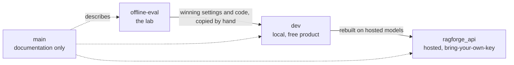
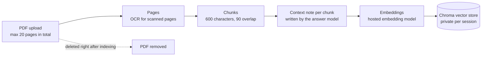
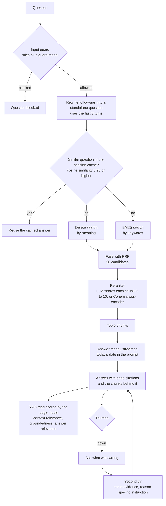
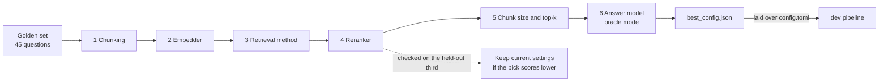

# RAGForge: the complete guide

One page covering the whole project: the branches, the RAG workflow, the settings, the models, the evaluation, the decisions,
privacy and setup. The same content is available as a styled web page in [`index.html`](index.html).

**Contents:** [Overview](#overview) · [Branches](#branches) · [RAG workflow](#rag-workflow) · [Stage details](#stage-details) ·
[Settings](#settings) · [Models](#models) · [Evaluation](#evaluation) · [Decisions](#decisions) ·
[Privacy and safety](#privacy-and-safety) · [Setup](#setup) · [Known limits](#known-limits)

---

## Overview

RAGForge answers questions about PDF documents and shows its work: page citations, the passages each answer came from, a live
quality score and, in the hosted version, what the answer cost.

It started as a learning project with two goals: build a retrieval-augmented generation (RAG) system, and learn how to
evaluate one properly. It produced three kinds of work, kept on separate branches: a lab that measured components against a
hand-built test set, a local free product, and a hosted bring-your-own-key product.

**Every version does the following.**

- Answers questions about uploaded PDFs, including scanned pages (read with OCR), with page citations.
- Searches two ways at once, by meaning (vectors) and by keywords (BM25), fuses the results, then re-sorts the best
  candidates with a reranker before an answer model writes the response.
- Shows the evidence: the retrieved passages and their scores sit next to each answer.
- Scores itself with the RAG triad (is the retrieved text on topic, is the answer backed by it, does it answer the question).
  This needs no reference answers, so it works on any document.
- Screens every question for prompt injection, and refuses rather than invents.
- Remembers the last few turns to handle follow-ups, and answers repeated questions from a private session cache.
- Takes thumbs up or down on every answer. A thumbs down asks what was wrong and offers a better second try.

The hosted version adds usage and cost tracking, a choice of provider and model per component, upload limits and privacy
handling for a public server.

## Branches

Work flows one way: experiments in the lab, the winners into the local product, then a rebuild on hosted models. The branches
are not merged; changes are carried across by hand because each one swaps the models underneath the same pipeline.



| | `offline-eval` | `dev` | `ragforge_api` |
|---|---|---|---|
| Purpose | Find the best settings | Free, private product | Shareable hosted product |
| Models | Local | Local | Hosted, user's own key |
| Costs the user | Nothing | Nothing | API usage, shown per answer |
| Documents leave the machine | No | No | Yes, to the chosen provider |
| Web app | Basic | Full | Full, with provider choice and cost |
| Guard, cache, feedback | No | Yes | Yes |
| Hardware | Large | About 24 GB RAM by default | Small server (about 2 GB) |
| State | Frozen since late October | Stable | Current, most advanced |

`main` holds no code. The hosted code that used to live there continues on `ragforge_api`; the last code commit on `main` was
`c81f5d4`. A deeper per-branch description is in [BRANCHES.md](BRANCHES.md).

## RAG workflow

Two paths. Indexing runs once per document set. Answering runs on every question. The numbers shown are the hosted defaults.

### 1. Indexing



### 2. Answering



The triad runs in the background so the answer appears first. A thumbs-down retry reuses the retrieved chunks, or searches
wider if the reason points at missing sources.

### 3. How the offline evaluation feeds the product



Each stage's winner carries forward to the next. Stages 1 to 5 rank on two of every three golden questions; the retrieval
pick is then checked on the held-out third.

## Stage details

| Stage | What it does | Why it is there |
|---|---|---|
| Page reading | Extracts text from each page. Scanned pages go through OCR (needs Tesseract). | Scanned papers and forms still work. Only PDFs are accepted; standalone images are not. |
| Chunking | Splits pages into recursive chunks of 600 characters with 90 overlap. Each chunk gets a short AI-written context note. | Small chunks keep answers precise. The note helps single searches find a chunk. Answers and citations always use the chunk's own text, never the note. |
| Embeddings | Turns each chunk into a vector. Each embedding model gets its own store. | Search by meaning. |
| Input guard | Rules plus a small guard model check each question. Questions over 1,000 characters are blocked. | Stops prompt injection and other malicious input before anything is retrieved. |
| Follow-up rewrite | Rewrites a follow-up ("which paper introduced it?") into a standalone question using the last 3 turns. | Search needs a self-contained query. |
| Session cache | Reuses the answer to a question 0.95 or more similar to an earlier one in the same conversation. | Saves a full pipeline run. Lives in a private folder and is deleted with the session. |
| Hybrid search | Dense and BM25 results are fused with reciprocal rank fusion (constant 60) into 30 candidates. | Each search alone misses things the other finds. |
| Reranker | Re-scores the 30 candidates and keeps the best 5. Either an LLM rates each chunk 0 to 10 (about 30 calls), or Cohere's cross-encoder scores all in one call. | The biggest retrieval gain: the right page was usually retrieved but not first. If Cohere fails, the plain search order is kept and the failure is logged. |
| Answer model | Writes a cited answer from the top 5 chunks, streamed. Gets today's date. | Answers the supported parts of a question and says plainly what the documents do not cover. Replies "I can't find that in the documents." only when none of the question can be answered. |
| RAG triad | A judge model scores three links with DeepEval, each 0 to 1 with reasons. | Live quality signal without reference answers. The judge should differ from the answer model. |
| Feedback and retry | Thumbs up or down. A thumbs down offers reasons (wrong or missing source, wrong citation, made something up, incomplete, too long) and a second try. | Lets a user recover a bad answer. Ratings are stored with the session and deleted with it. |
| Usage tracking | Counts every model call, its tokens and an estimated cost, per component, per turn and per session. | Bring-your-own-key users should see what they spend. A model missing from the price list is counted as an unpriced call. |

| RAG triad score | Link it checks | Points at |
|---|---|---|
| Context relevance | Question to retrieved chunks: how much of the retrieved text is on topic | Retriever and reranker |
| Groundedness | Chunks to answer: are the answer's claims supported by the retrieved text | Generator |
| Answer relevance | Question to answer: does the answer address the question | Generator and prompt |

Low context relevance with high groundedness means search brought noisy passages and the answer stayed faithful to them. High
context relevance with low groundedness means the model added claims its sources do not support.

## Settings

One config file holds every setting. In the hosted web app, the sidebar's model choices override the model settings for that
session. In the local version, a file written by the evaluation (`best_config.json`) is laid over the config file.

| Setting | Default | Meaning |
|---|---|---|
| Chunk size and overlap | 600 / 90 | Characters per chunk and overlap between neighbours |
| Context notes | on | An LLM adds a note to every chunk (slow to build, one call per chunk) |
| Candidates before rerank | 30 | Raised from 20 after a wrong answer traced to a passage that never reached the reranker |
| Chunks returned | 5 | Top results given to the answer model |
| RRF constant | 60 | Score is 1 divided by (constant plus rank) |
| Default method | hybrid + rerank | Others: dense, BM25, hybrid, multi-query hybrid + rerank |
| Answer length | 256 tokens | Longest reply the answer model writes |
| Memory | 3 turns | Past question and answer pairs remembered |
| Cache threshold | 0.95 | Cosine similarity needed to reuse an answer |
| Guard length limit | 1,000 characters | Longer questions are blocked |
| Reranker type | llm | An LLM scores each chunk, or switch to Cohere's cross-encoder |
| Request timeout and retries | 60 s / 2 | One stalled call cannot freeze the page |
| Rerank rate limit | off | Set to 9 calls a minute for a Cohere trial key (limit 10) |
| Page limit | 20 pages | Total across all uploads; checked on the page and again before indexing |
| File size | 25 MB | Per uploaded file |

## Models

### Hosted version: a provider and model per component

| Component | OpenAI | Anthropic | Gemini |
|---|---|---|---|
| Answers, retries, chunk notes | `gpt-4o`, `gpt-4o-mini`, `gpt-4.1`, `gpt-4.1-mini` | `claude-sonnet-5-5`, `claude-opus-5-5`, `claude-haiku-5-5` | `gemini-3.5-flash`, `gemini-3.5-flash-lite`, `gemini-3.6-flash`, `gemini-3.1-flash-lite` |
| Input guard, judge | the same chat models | the same | the same |
| Reranker | the same chat models, scoring each chunk 0 to 10; or Cohere's cross-encoder (`rerank-v3.5`, `rerank-v4.0-pro`, `rerank-v4.0-fast`) with a Cohere key | | |
| Embeddings | `text-embedding-3-small`, `-3-large` | not offered | `gemini-embedding-001`, `gemini-embedding-2` |
| Voice input (optional) | `whisper-1`, `gpt-4o-transcribe` | not offered | not offered |

"Custom" lets you type any other model name. Defaults are all OpenAI, so one key is enough to start. Anthropic is chat-only, so
pair it with OpenAI or Gemini for embeddings.

### Local version: default models

| Job | Model |
|---|---|
| Answers and second try | `qwen3:14b` (or `gemma3:4b` on a smaller machine) |
| Input guard and judge | `mistral:7b`, kept different from the answer model |
| Embeddings | `all-minilm` |
| Reranker | `mxbai-rerank-base-v1` cross-encoder (about 1 GB, downloaded on the first question) |
| Speech to text | faster-whisper on the CPU |

## Evaluation

A RAG system can fail by retrieving the wrong passages or by writing a poor answer from good ones. Evaluation exists to tell
those apart.

- **Component evaluation** runs against a golden set of 45 questions over three papers (LoRA, QLoRA, "Attention Is All You
  Need"). Each question has a reference answer and the pages that contain it. It compares versions of each part, offline.
- **RAG triad** needs no reference answers. It scores every live answer, so it works on any uploaded document.

| Stage | Question it answers | Metrics |
|---|---|---|
| Retriever | Does search find the right pages, and near the top? | Recall@K, Precision@K, Hit Rate@K, MRR |
| Reranker | Does re-sorting move the right page up? | The same four, with and without |
| Chunking | Do context notes help? | The same four, per method |
| Generator | Is the answer faithful, relevant and correct? | Faithfulness, answer relevancy, correctness, similarity, context recall |
| Generator, oracle | Same, handed the right pages | The same five; isolates the answer model from search |
| RAG triad | Does the whole pipeline hang together? | Context relevance, groundedness, answer relevance |
| Latency | Where does the time go? | Seconds per stage |

**Safeguards in the method**

- A different model judges than answers, so no model grades itself. The same answers scored 0.97 for correctness under a
  lenient judge and 0.80 under a stricter one, so only compare runs that used the same judge.
- Relevance is judged by page, so chunking strategies can be compared on equal terms. Scores are slightly generous as a result.
- Settings were tuned on two thirds of the questions and checked on the rest. Near-ties (within 0.01 MRR) go to the faster option.
- With 45 questions, one question moves a score by about 0.02, so gaps of a few hundredths are noise.

### Hosted results (OpenAI, all 45 questions)

`gpt-4o` answers; `gpt-4o-mini` is guard, judge and reranker; `text-embedding-3-small` embeds.

| Retrieval method | Recall@1 | Recall@5 | MRR | Hit Rate@5 |
|---|---|---|---|---|
| Dense | 0.49 | 0.82 | 0.71 | 0.89 |
| BM25 | 0.57 | 0.82 | 0.74 | 0.91 |
| Hybrid | 0.62 | 0.89 | 0.79 | 0.93 |
| **Hybrid + rerank** | **0.72** | **0.92** | **0.88** | **0.96** |

| Generator and triad | Score |
|---|---|
| Answer correctness | 0.98 |
| Context recall | 0.92 |
| Faithfulness, retrieved chunks / golden pages | 0.71 / 0.94 |
| Triad: context relevance / groundedness / answer relevance | 0.41 / 0.72 / 0.94 |

| Latency stage | Seconds per question |
|---|---|
| Input guard | 0.8 |
| Search | 0.8 |
| Rerank | 3.8 |
| Answer | 1.3 |
| **Triad scoring** | **39** |

The triad is the slowest part of a turn and a large share of its cost, because each metric makes several judge calls. A full
run on OpenAI cost about $1.3 for the stages plus about $0.7 once to build the index, and took about 100 minutes. Results are
saved so they never need to be paid for again. The full tables are in [EVALUATION_RESULTS.md](EVALUATION_RESULTS.md).

### What else was found

- **A reranker is the biggest single gain.** Locally, hybrid MRR went from 0.74 to 0.92; the right page was usually already
  retrieved, just not first.
- **A purpose-built cross-encoder beat a small chat model as reranker.** Chat-model rerankers made local retrieval worse than
  no reranker at all.
- **Bigger rerankers were not better.** Hosted `gpt-4o` reached MRR 0.89 against 0.86 for `gpt-4o-mini`, at far higher cost.
- **Context notes helped single searches but not the reranked pipeline.** Plain chunks scored MRR 0.91 against 0.87 with notes,
  and the notes add a one-time indexing cost. They are still on by default.
- **Most of the faithfulness gap is retrieval.** Faithfulness was 0.71 with retrieved chunks and 0.94 with the golden pages.

### Fixes made after the full run

| Check | Finding | Change |
|---|---|---|
| 15 questions through the real app | 9 of 11 answerable correct; both out-of-scope refused; injection blocked; repeat served from cache; about 39 calls and $0.007 a turn. Two answerable questions wrongly refused (a two-part question and a follow-up). | Answer prompt now answers the supported parts and says which part the documents do not cover |
| "What rank did the GPT-3 experiments use?" | The right passage was never among the 20 candidates | 30 candidates. Whole set: Recall@3 0.878 to 0.922, MRR 0.866 to 0.888, about 2 s slower per query |
| Stricter answer prompt | Faithfulness 0.71 to 0.93, correctness unchanged, out-of-scope still refused | Adopted |
| Multi-query retry search | MRR 0.871 against 0.866 for about 50% more time; within noise | Not made the default |

> **Not measured.** Quality for Gemini, Cohere and Anthropic on the full golden set (Anthropic ran 7 questions end to end with
> no errors, at about $0.011 a question against about $0.007 on OpenAI). Local-version latency. Documents other than three
> research papers. A vague question like "what rank r does LoRA use?" stays unreliable because the paper uses different ranks
> in different places.

More detail: [EVALUATION.md](EVALUATION.md) and [RAG_EVALUATION.md](RAG_EVALUATION.md).

## Decisions

| Decision | Why | Trade-off | Branch |
|---|---|---|---|
| Build the evaluation as a first-class part | A system you cannot measure cannot be improved | Slower to a first demo | all |
| Separate branches for lab, local and hosted | Each answers a different question and swaps the models under the same pipeline | Changes are carried by hand | all |
| Plain, readable classes over heavy frameworks | The code must stay understandable later | Some things written by hand | all |
| Vectors in a local folder; no database server, no containers | Tens of pages, simplest to run; a Postgres and Docker design was deferred | Not built for many concurrent users | all |
| Hybrid search, then always rerank | Combined search finds more; the reranker puts the right page first | Extra latency, and cost when the reranker is an LLM | all |
| Cross-encoder reranker, not a chat model | A small chat model made retrieval worse than none | A one-time model download | `dev` |
| Reranker is the user's choice: LLM or Cohere | LLM scoring costs about 30 calls a question; a cross-encoder is one | Cohere trial keys are rate-limited | `ragforge_api` |
| Score relevance by page | Lets chunking strategies be compared fairly | Slightly generous scores | `offline-eval` |
| Tune on two thirds, check on one third | Guards against settings that only fit the tuning questions | Fewer tuning questions | `offline-eval` |
| Rank 30 candidates, not 20 | A real wrong answer traced to a passage that never reached the reranker | About 2 s more a query | `ragforge_api` |
| Answers use the original passage, not the AI note | The note helps search, but should not be what users read or what is cited | None | `dev`, `ragforge_api` |
| Bring your own key | The operator pays nothing and holds no secrets; users see their spend | Every user needs a provider account; uploads go to that provider | `ragforge_api` |
| One gateway for every provider | A new provider is configuration, and cost tracking comes with it | Depends on the gateway's price list | `ragforge_api` |
| No local models in the hosted version | One-command install, small server | Everything uploaded goes to the provider | `ragforge_api` |
| Plain server with a proxy for HTTPS; no Docker | Fewest moving parts at this scale | No automatic scaling | `ragforge_api` |

**Deliberately not done:** no cloud database, containers or job queue (designed, deferred as unnecessary at this scale); no
long-term user memory or accounts, only short-term conversation memory; no measured quality for providers other than OpenAI;
no standalone image upload. The full log is in [DECISIONS.md](DECISIONS.md).

## Privacy and safety

| Concern | How it is handled |
|---|---|
| API keys | Held in session memory only. Never written to disk or logged. |
| Uploaded PDFs | Deleted as soon as they are indexed. |
| Index and answer cache | Live in a private per-session folder in the system temp directory. Removed when documents are replaced, when the session ends (reload, closed tab, new session) and on every server restart. |
| Ratings | Stored with the session cache and deleted with it. Nothing about a user persists. |
| Prompt injection | Every question passes the input guard before anything is retrieved. |
| Invented answers | The answer prompt refuses rather than invents and never uses outside knowledge. |
| Oversized uploads | 20-page total and 25 MB per file, checked on the page and again before indexing, so an oversized file never reaches a model. |
| Stalled providers | Every model request has a 60 second timeout and is retried twice. |
| Where documents go | Hosted: to the providers the user chose, who also bill them. Local: nowhere. |

> **No login or rate limit.** Costs fall on each user's own key, but anyone who can reach the page can use the server's CPU and
> memory. If it is not meant to be public, put it behind a login (for example Caddy `basic_auth`), a VPN or an IP allow-list.

## Setup

The `main` branch has no code, so clone one of the code branches. Common to all: install [uv](https://docs.astral.sh/uv/).
Scanned PDFs also need Tesseract (`brew install tesseract` or `apt install tesseract-ocr`). The web app opens at
`localhost:8501`.

### Hosted version (`ragforge_api`)

```bash
git clone -b ragforge_api https://github.com/janarddansarkar/RAGFORGE.git && cd RAGFORGE
uv run streamlit run src/app.py
```

- The first run installs the packages. No model is downloaded.
- Pick a provider and model for each component in the sidebar and paste a key for each provider you chose. One OpenAI key is
  enough to start.
- Upload PDFs (20 pages in total) and click Ingest. The first ingest is slow because every chunk gets a context note.
- Changing a provider or model resets the documents; click Ingest again.
- One question from the command line: `uv run python src/triad.py your.pdf "your question"`.

### Local version (`dev`)

```bash
git clone -b dev https://github.com/janarddansarkar/RAGFORGE.git && cd RAGFORGE
./setup.sh    # installs Ollama if needed, the packages and the models
./run.sh      # starts the web app
```

- Default models are about 14 GB and want about 24 GB of RAM. On a smaller machine switch the answer model to `gemma3:4b`
  (about 8 GB of models, 16 GB of RAM) in the two config files and run setup again.
- The first question downloads the reranker (about 1 GB). After that it works offline.
- Command line: `uv run python src/rag.py documents/LoRA.pdf "What rank r does LoRA use?"`

### Evaluation lab (`offline-eval`)

```bash
git clone -b offline-eval https://github.com/janarddansarkar/RAGFORGE.git && cd RAGFORGE
ollama pull bge-m3 qwen2.5:3b mistral:7b
uv sync
uv run python eval/find_best.py --limit 5 --no-save    # quick smoke test, writes nothing
```

The full search takes hours. `--stages` runs only some stages, `--no-save` writes nothing, `--skip-missing` leaves out models
you have not pulled. It checks every needed model is downloaded first and prints the exact commands for any that are not.

### Running the hosted evaluation

```bash
uv run python eval/run_provider_eval.py openai --limit 10   # cheaper trial
uv run python eval/run_provider_eval.py openai              # everything, about 100 minutes
uv run python eval/make_report.py                           # rebuild the report from saved data, free
```

It costs real money, so read the saved results first. A free-tier Gemini key (5 requests a minute) cannot complete it. Unit
tests need no keys: `uv run pytest`.

### Deploying the hosted version on a server

| Step | What to do |
|---|---|
| Needs | About 2 GB RAM (around 560 MB for one user, plus about 160 MB for the scoring library; 1 GB works only with swap), about 1 GB disk, `git`, `curl`, `tesseract-ocr`, and a domain name for HTTPS. |
| 1. Install and run | Clone the branch and start the app listening only on `127.0.0.1`, so it is not directly reachable from outside. |
| 2. Keep it running | A systemd service with `Restart=always` and `PrivateTmp=true`. The private temp folder is deleted when the service stops, a second guarantee that no upload survives a restart. |
| 3. HTTPS | A reverse proxy such as Caddy gets and renews a certificate and passes the WebSocket Streamlit needs. Open only SSH, 80 and 443; keep 8501 closed. Users type API keys into the page, so never serve it over plain HTTP. |
| 4. Update | `git pull` and restart the service. |

Full commands and the service file are in `docs/DEPLOY_VPS.md` on the `ragforge_api` branch. It was tested locally with a real
server and browser, not on a VPS. Scanned PDFs are slow on a small server because OCR runs on the CPU.

## Known limits

- The golden set is small: 45 questions over three research papers.
- Hosted quality was measured with OpenAI only. Gemini, Cohere and Anthropic were exercised end to end but not scored on the
  full set.
- Costs shown are estimates from a price list; the provider's bill is the truth.
- No login or rate limit in the hosted app.
- Only PDFs are accepted; standalone images are not.
- If a connection drops and the private session folder is cleaned up meanwhile, the app asks the user to upload again.
- Claude models "think" before answering and the thinking counts against the token limit. The app asks for minimal thinking and
  adds 512 tokens of headroom; otherwise some answers came back empty.
